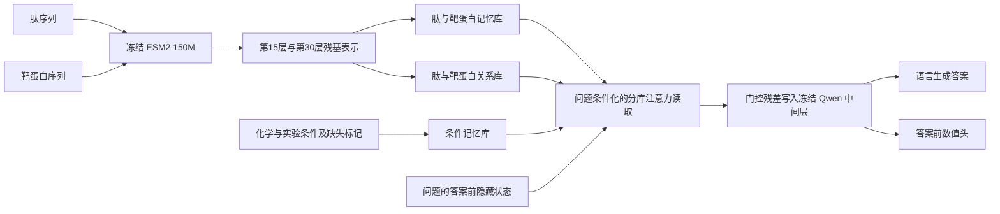

# 蛋白质语言连接器架构与多任务验证

本轮将亲和力 pKD 之外的验证落实为五个有真实数据的面板：热稳定性、未见功能描述检索、色谱保留时间、已知阳性靶点排名和变体方向诊断。热稳定性新增官方数据和实际CPU基线，其余四项对已有预测完成独立复算。当前V4连接器的神经网络训练仍对应pKD；这些基础结果用于下一轮任务训练的对照。

定时监控已按用户要求关闭。关闭的是应用中的定时检查，node1现有训练队列继续执行自己的冻结计划。

## 当前实际架构



1. **分子编码。** ESM2-150M分别编码肽和参考靶蛋白，读取H15、H30。长序列按最多1022残基分块，保留全部残基后池化；分块之间的ESM上下文断开，池化会压缩信息。
2. **四类记忆。** 肽P、靶蛋白T、实验条件C和关系R分别保存。P/T/R在两个视图各8槽，C为共享10槽；总共58×128维。条件缺失有独立状态，原始数据中的未知温度、pH和实验构建体不会变成真实观测。
3. **问题路由。** 用答案前的prompt隐藏状态控制bank和来源层权重。读取结果经小投影和门控残差写入Qwen内部，不新增文本位置。1.5B写入第14个decoder块后，4B写入第18块后。
4. **双输出。** Qwen生成严格的单字段pKD JSON；独立数值头从答案前状态给出数值。两通道分别评价。改变任务的输出模板、损失和评分器后，主干可承担分类、排序或文本任务。
5. **训练。** ESM与Qwen冻结，只训练记忆投影、读取器、路由、条件嵌入、门控和数值头。当前损失是答案token交叉熵加训练集标准化数值MSE；验证集答案NLL选点。尚未进行多任务联合训练或LoRA微调。

实际源码快照见上级V4的 `resources/node_shared_scope/src`；公开副本见 `../backbone_comparison_v4_20261017/node_shared/src`。pKD的数据格式、prompt、数值头和评分均有任务专用实现，增加任务需要独立适配器。

## M0与M3比较的含义

| 内容 | M0同容量基础控制 | M3完整连接器 |
|---|---|---|
| 两个ESM来源视图 | H30与H30，投影独立 | H15与H30 |
| 路由条件 | 固定非零anchor，路由仍可训练 | 当前问题的prompt状态 |
| 关系信息 | 肽自身关系 | 肽读取靶蛋白的关系 |
| 相同底座内接口参数和槽数 | 与M3相同 | 与M0相同 |

M0本身已经包含多bank和注意力读取，不是单个MLP。1.5B接口为1,618,568个参数，4B为1,884,808个；跨底座容量不同。两者每行逻辑记忆载荷均为29,696字节，实际显存流量和FLOPs另计。

本轮24组比较的是三项变化的整体组合。定位模块贡献需要追加M1（只加中间层）、M2（再加问题路由）、M3（再加跨分子关系）和full-minus单模块消融；现有开关不等于已经取得消融结果。

## 已建立的非pKD基础测试

| 面板 | 固定测试范围 | 指标 | 本轮实际工作 |
|---|---|---|---|
| FLIP human热稳定性 | train7287／validation861／test1945 | Spearman主指标；MAE、RMSE、覆盖率及精确序列分组补充 | 新下载官方划分；均值及组成Ridge实际CPU建模、评分、独立重算 |
| ELM未见功能描述 | 31候选，76测试实例，仅2个留出功能类 | 类宏MRR、Recall@1/3及样本平均 | 2个历史架构×3种子的完整排名复算 |
| March保留时间 | 同一色谱条件下1063测试实例 | MAE、RMSE、Spearman、区间覆盖率和宽度 | 3个历史CPU基线复算，保留selection与calibration分工 |
| Benz已知阳性靶点排名 | 34候选、387测试肽 | 已知阳性Recall@1/3、MRR | 频率、近邻及历史ESM-MLP排名复算 |
| Kliche方向诊断 | D2测试9对／暴露排除后5对，G1源一致实测14对 | accuracy、balanced accuracy、输入交换一致性 | 9个历史方法／种子×3子集复算，保持小样本与弱监督标签 |

复算共39条模型／种子／子集记录，见 `results/existing_replay_v1/scores.json` 和 `metrics.csv`。这是历史结果的重新核实；新热稳定性结果见 `results/meltome_human_v1/cpu_baseline_v1/`。两个模块各有13项CPU测试通过，另有独立数值与来源哈希核验。

| 实际基础结果 | 成绩 | 解读 |
|---|---|---|
| 新热稳定性组成Ridge | Spearman0.50423；MAE3.44487°C；RMSE4.26147°C | 后续连接器需要超过的简单序列规律参照 |
| 新热稳定性训练均值 | MAE4.05198°C；RMSE4.90953°C；常量Spearman为null | 全部1945个测试预测有效 |
| 历史ELM两个架构各3种子 | Recall@3全部0 | 未见功能语义迁移仍存在明显缺口 |
| 历史RT Ridge | MAE3.9404min；Spearman0.9213；90%目标区间实际覆盖87.77% | 较强的同条件性质基线，连接器必须公平对比 |
| 历史Benz ESM-MLP试跑 | MRR0.6814；Recall@3为0.7550 | 该成绩属于历史工程划分与单种子试跑 |

同一表中不对不同任务的数值做加总排名。ELM与Benz中未标注的关系保持未知；RT此处为同条件诊断。热稳定性同划分内重复行全部保留，精确序列跨划分重复为0；官方20%聚类规则是来源信息，CSV缺少原始蛋白ID，逐行cluster映射尚不能独立核实。

## 下一轮连接器验证

第一批神经任务固定为 **热稳定性、ELM功能描述、RT性质**；Benz和Kliche补充双分子识别与比较诊断。各任务先建立输入适配和TRAIN资格检查，再冻结任务内共同预算，按M0/M3、两底座、种子17/42/2026执行。不同任务样本数和序列长度不同，训练预算分别登记；现有pKD测试集和合同不改。

单序列任务显式标记target不存在，并关闭T/R支路；不能复制本体或填随机靶蛋白来凑输入。功能任务使用固定候选描述和任务专用排序监督；性质任务使用独立的训练统计、单位及头。先完成分任务训练与评价，再登记统一多任务模型的采样权重和统一验证选点；逐任务挑checkpoint的拼表不能代表一个统一模型。

单分子任务的两臂同时关闭T/R，重新核算实际活动参数和通信量；这些测试检验来源层、路由与语言语义对接。跨分子关系模块仍由肽—靶点排名和成对方向任务评价。ELM类别留出任务需利用候选的文字描述，不以固定类别ID分类头替代未见类别泛化。

每个任务完成预登记种子和步骤，早期增益小不会触发逐种子放弃；训练停止依据数值、数据、资源错误或预先登记的结束条件。

每项使用以下四类对照，尽量匹配分子输入、训练标签、调参次数及参数／通信预算：

- ESM表示加任务头，检查语言模型之外的预测能力；性质任务增加组成Ridge和近邻。
- 纯文本Qwen，检查文本上下文或训练标签分布能达到什么水平。
- ESM预测器加Qwen输出的流水线，检查内部连接是否优于已有预测器的语言包装。
- 同容量M0、完整M3及逐模块消融，分别评价连接器组合和模块贡献。

每个checkpoint同时检查预测／生成质量与分子输入依赖。已有C1 on/off衡量连接器分支依赖；补充问题改写一致性、答案前状态隔离和有合格来源的输入替换。合法独立donor缺失时保留未定义，不从未测关系造负例。生成通道报告严格格式率、完整测试分母和任务正确性，数值头单独统计。

第二批加入 **蛋白—文本双向检索及有证据的功能问答**，验证语言接口本身。ProtT3提供检索先例；候选池、正例集合、序列划分和数据暴露需先冻结。完整测试池与64条批内检索分别报告。现有OPUS原始问答尚未完成本项目gold与暴露审核；4277张证据登记也不等于4277条可评分QA。事实正确性用受审核的答案与证据评分，BLEU／ROUGE作文本相似性补充。

## 一键运行与保留结果

在本项目目录执行；使用现有Python和NumPy，无新增依赖、无GPU：

```powershell
python experiments/multitask_benchmark_v1_20261017/run_suite.py --verify
python experiments/multitask_benchmark_v1_20261017/run_suite.py --run-id new_unique_run
```

统一入口拒绝重复运行编号，保留历史分数、原始数据和全部派生结果。`--verify`核对本机原始数据与结果指纹；新run执行四类历史预测复算和热稳定性CPU基线。旧pKD模型训练不由该入口启动或停止。

官方数据可通过 `python src/meltome.py download --config configs/meltome_human_v1.json` 获取，命令在本scope执行。公开副本提供原数据校验值、官方地址和许可；本机原件完整保存。

历史复算需要原项目的规范数据和预测目录；公开仓库保留派生分数与原件指纹，规范化的公开目录不冒充私有执行目录。热稳定性模块可在本scope单独download、audit、run；运行时以保留的配置和源码版本为准。

## 论文和官方数据依据

- [FLIP](https://datasets-benchmarks-proceedings.neurips.cc/paper_files/paper/2021/hash/2b44928ae11fb9384c4cf38708677c48-Abstract-round2.html)；[作者固定版Meltome划分](https://raw.githubusercontent.com/J-SNACKKB/FLIP/62cace8735f5610e2743cf06ce0f944b37fffaa6/splits/meltome/README.md)；[原始Meltome实验](https://www.nature.com/articles/s41592-020-0801-4)。热稳定性为实验表型，受细胞与复合体环境影响。
- [ELM 2024](https://doi.org/10.1093/nar/gkad1058)；[Benz 2022及实验附录](https://link.springer.com/article/10.15252/msb.202110584)。本项目的类别留出与排名规则为已登记的项目协议，实验来源与项目基准分开记录。
- [ProtT3 ACL 2024](https://aclanthology.org/2024.acl-long.324/)；[作者仓库](https://github.com/acharkq/ProtT3)，支持蛋白—文本检索与文本生成测试设计。
- [TAPE](https://arxiv.org/abs/1906.08230)、[FLIP作者仓库](https://github.com/J-SNACKKB/FLIP)提供荧光、稳定性和分布外序列评价范式，可作为后续追加任务。
- [ProtNote](https://academic.oup.com/bioinformatics/article/41/5/btaf170/8113843)提供开放功能描述和同信息判别式基线依据；采用语言模型的增益仍由本项目对照确定。

本轮测试范围、来源和下一步状态集中登记在 `benchmark_registry.json`；已有results目录保持原始字节，新增运行保存到独立编号。
