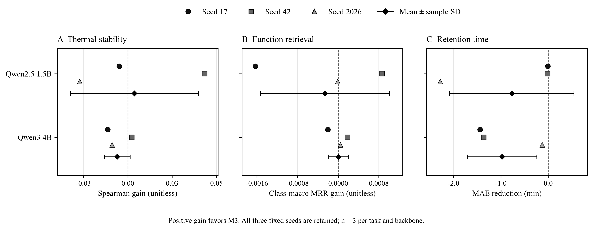

# M3与M0的同种子差值图

18个固定配对全部保留。正值表示M3更好，点为三个种子，黑色菱形和误差线为均值与样本标准差；未添加显著性检验。完整模型结果见[三任务报告](../independent_math_review_v1/REPORT.md)。

[PDF图版](report.pdf) · [图注](caption.md) · [数据核验](00_data_health.md) · [逐点复算表](process_data/fig_01_data.xlsx)

复现时使用资源目录中的plot_multiseed_stability_v1.py；输入指向已公开的同SHA汇总JSON，输出到新分析目录。
